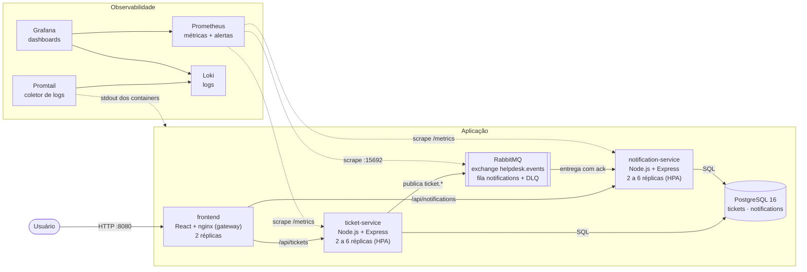
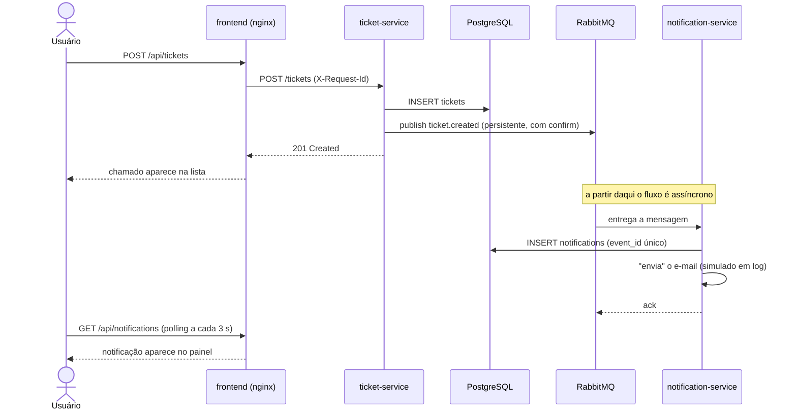

# Arquitetura da solução — HelpDesk Cloud

**Autor:** Joaquim Luiz Vitória Junior · **Disciplina:** Arquitetura de Computação em Nuvem · **Professor:** Erik Rosa Filippini

## 1. Contexto e requisitos

**Problema.** Pedidos de suporte de TI chegam por canais informais, se perdem e não têm acompanhamento. O solicitante não sabe se o pedido foi recebido nem em que pé está.

**Requisitos funcionais**

- Abrir chamado com título, descrição, e-mail do solicitante e prioridade (baixa, média, alta).
- Listar chamados e alterar o status (aberto, em andamento, resolvido, fechado).
- Notificar o solicitante quando o chamado é aberto e a cada mudança de status.
- Consultar o histórico de notificações enviadas.

**Requisitos não funcionais**

- A abertura de chamado não pode depender do envio da notificação (desacoplamento por mensageria).
- Nenhum componente de aplicação pode ser ponto único de falha.
- Todo componente expõe métricas e logs estruturados.
- Ambiente reproduzível por código, sem custo de nuvem.

## 2. Desenho da arquitetura



## 3. Componentes

| Componente | Responsabilidade | Detalhes técnicos |
|---|---|---|
| **frontend** | Interface web e ponto único de entrada | SPA em React compilada com Vite. O nginx serve os arquivos estáticos e encaminha `/api/tickets` e `/api/notifications` para os microsserviços, gerando um `X-Request-Id` por requisição. |
| **ticket-service** | CRUD de chamados e publicação de eventos | API REST em Express. Grava no PostgreSQL e publica `ticket.created` / `ticket.status_changed` no RabbitMQ com mensagens persistentes e *publisher confirms*. |
| **notification-service** | Consumo de eventos e registro das notificações | Consome a fila `notifications` com *ack* manual. O envio do e-mail é simulado (registrado em log e no banco). Expõe `GET /notifications`. |
| **RabbitMQ** | Mensageria | Exchange `helpdesk.events` (topic), fila durável `notifications` ligada a `ticket.*` e *dead-letter queue* `notifications.dlq`. |
| **PostgreSQL** | Persistência | Tabela `tickets` (dono: ticket-service) e `notifications` (dono: notification-service). Cada serviço cria e acessa apenas as próprias tabelas. |

### API

| Método | Rota | Serviço | Descrição |
|---|---|---|---|
| GET | `/api/tickets` | ticket-service | Lista os chamados (`?status=` opcional) |
| POST | `/api/tickets` | ticket-service | Abre um chamado |
| GET | `/api/tickets/:id` | ticket-service | Consulta um chamado |
| PATCH | `/api/tickets/:id` | ticket-service | Altera o status |
| GET | `/api/notifications` | notification-service | Lista notificações (`?ticketId=` opcional) |
| GET | `/healthz`, `/readyz`, `/metrics` | ambos | Liveness, readiness e métricas (uso interno) |

## 4. Fluxos

### 4.1 Abertura de chamado (síncrono + assíncrono)



### 4.2 Tratamento de falhas na mensageria

- **notification-service fora do ar:** as mensagens ficam na fila durável e são processadas quando ele volta. A abertura de chamados não é afetada.
- **Falha ao processar (ex.: banco indisponível):** a mensagem recebe *nack* e volta para a fila uma vez. Na segunda falha vai para `notifications.dlq`, onde fica disponível para análise e reprocessamento, e um alerta é disparado.
- **Entrega duplicada:** o `event_id` é chave única na tabela `notifications`, então a mesma mensagem processada duas vezes gera uma única notificação (consumidor idempotente).
- **RabbitMQ fora do ar:** o chamado é gravado normalmente, a falha de publicação é registrada em log e na métrica `events_published_total{result="erro"}`. Os dois serviços se reconectam sozinhos a cada 3 segundos.

## 5. Ambientes

| | Docker Compose | Kubernetes (kind) |
|---|---|---|
| Finalidade | Desenvolvimento e demo rápida | Demonstração de HA e escalabilidade |
| Provisionamento | `docker compose up` | Terraform (`infra/terraform`) + Kustomize (`infra/k8s`) |
| Réplicas dos serviços | 2 fixas | 2 a 6, com HPA |
| Nós | 1 (a máquina local) | 1 control-plane + 2 workers |
| Descoberta de serviço | DNS do Docker | Services do Kubernetes |
| Observabilidade | Prometheus, Loki, Promtail e Grafana em containers | kube-prometheus-stack e loki-stack via Helm |

### Infraestrutura como código

O Terraform (`infra/terraform`) cria:

1. o cluster **kind** com três nós e as portas 8080, 3000 e 9090 expostas em `localhost`;
2. o **metrics-server**, que fornece as métricas de CPU usadas pelo HPA;
3. o **kube-prometheus-stack** (Prometheus Operator, Prometheus, Alertmanager e Grafana);
4. o **loki-stack** (Loki e Promtail).

Os manifestos da aplicação (`infra/k8s`) são aplicados com `kubectl apply -k` e incluem Deployments, Services, HPAs, PodDisruptionBudgets, ServiceMonitors, regras de alerta e o dashboard do Grafana.

## 6. Alta disponibilidade e escalabilidade

| Mecanismo | Como foi implementado | O que garante |
|---|---|---|
| **Réplicas** | Mínimo de 2 réplicas de frontend, ticket-service e notification-service | A queda de uma réplica não interrompe o serviço |
| **Serviços sem estado** | Nenhum serviço guarda sessão ou dado em memória; todo o estado está no PostgreSQL e no RabbitMQ | Qualquer réplica atende qualquer requisição; escalar é só adicionar réplicas |
| **Distribuição entre nós** | `topologySpreadConstraints` por `kubernetes.io/hostname` | A queda de um nó não derruba todas as réplicas de um serviço |
| **Health checks** | `startupProbe`, `livenessProbe` (`/healthz`) e `readinessProbe` (`/readyz`, que testa o banco) | Réplica travada é reiniciada; réplica sem banco sai do balanceamento |
| **Escalabilidade horizontal** | `HorizontalPodAutoscaler` de 2 a 6 réplicas, alvo de 70% de CPU | Capacidade acompanha a carga automaticamente |
| **Consumidores concorrentes** | Várias réplicas do notification-service na mesma fila, com `prefetch` de 10 | A vazão de notificações escala com o número de réplicas |
| **Deploy sem indisponibilidade** | `RollingUpdate` com `maxUnavailable: 0` e encerramento gracioso no `SIGTERM` | Atualização de versão sem derrubar requisições |
| **Proteção em manutenção** | `PodDisruptionBudget` com `minAvailable: 1` | Drenar um nó nunca remove todas as réplicas |
| **Desacoplamento** | Mensageria entre chamados e notificações | Falha ou lentidão nas notificações não afeta a abertura de chamados |
| **Resiliência de mensagens** | Fila durável, mensagens persistentes, *publisher confirms*, *ack* manual, DLQ, idempotência | Nenhuma notificação é perdida nem duplicada em caso de falha |
| **Reconexão automática** | Retentativas de conexão com o banco e com o broker | Os serviços se recuperam sozinhos da volta de uma dependência |

### Limitações conhecidas do ambiente local

PostgreSQL e RabbitMQ rodam com **uma instância cada**, pois o objetivo do ambiente local é custo zero. Eles são os pontos únicos de falha desta implantação. Além disso, a publicação do evento ocorre depois do *commit* no banco; se o broker estiver fora nesse instante, o chamado é salvo, mas o evento não é publicado.

### Evolução para produção em nuvem

| Componente local | Equivalente gerenciado (exemplo AWS) | Ganho |
|---|---|---|
| kind | EKS em três zonas de disponibilidade, com Cluster Autoscaler ou Karpenter | HA de control-plane e de nós; escala de infraestrutura |
| PostgreSQL em StatefulSet | RDS/Aurora PostgreSQL Multi-AZ com réplicas de leitura | Failover automático e backups |
| RabbitMQ em StatefulSet | Amazon MQ em cluster, ou SQS + SNS | Fila replicada entre zonas |
| NodePort | Application Load Balancer + Ingress, com TLS | Entrada balanceada e segura |
| Secret em manifesto | Secrets Manager + External Secrets | Segredos fora do Git |
| Publicação após o commit | Padrão *Transactional Outbox* | Garantia de publicação de todo evento |
| HPA por CPU | KEDA escalando o notification-service pelo tamanho da fila | Escala pelo indicador real de demanda |
| Envio de e-mail simulado | Amazon SES, ou uma função serverless (Lambda) acionada pela fila | Envio real e cobrança por uso |

## 7. Monitoramento e observabilidade

A solução cobre os pilares de **métricas** e **logs**, com correlação entre eles pelo identificador da requisição e do evento.

### 7.1 Métricas (Prometheus)

Cada microsserviço expõe `/metrics` com a biblioteca `prom-client`. O Prometheus descobre todas as réplicas automaticamente (DNS no Compose, `ServiceMonitor` no Kubernetes) e coleta a cada 10 segundos.

| Métrica | Tipo | Origem | Uso |
|---|---|---|---|
| `http_request_duration_seconds` | Histograma | ambos | Taxa de requisições, latência (p95) e taxa de erro, por rota e status |
| `tickets_created_total` | Contador | ticket-service | Indicador de negócio: chamados abertos, por prioridade |
| `tickets_status_changed_total` | Contador | ticket-service | Mudanças de status |
| `events_published_total` | Contador | ticket-service | Eventos publicados, com sucesso ou erro |
| `events_consumed_total` | Contador | notification-service | Eventos consumidos: ok, duplicado, descartado ou erro |
| `event_processing_duration_seconds` | Histograma | notification-service | Tempo de processamento de cada evento |
| `event_delivery_lag_seconds` | Histograma | notification-service | Tempo entre publicação e processamento (atraso da fila) |
| `rabbitmq_queue_messages_ready` | Gauge | RabbitMQ | Mensagens acumuladas na fila e na DLQ |
| `process_*`, `nodejs_*` | diversos | ambos | CPU, memória, *event loop* e *garbage collector* |
| `up` | Gauge | Prometheus | Réplicas no ar |

Essas métricas seguem o método **RED** (Rate, Errors, Duration) para as APIs e acrescentam indicadores de negócio e de mensageria.

### 7.2 Logs (Loki + Promtail)

- Os serviços escrevem **logs estruturados em JSON** no `stdout` (biblioteca `pino`), com `service`, `level`, `time`, e os campos de contexto `req.id`, `ticketId`, `eventId` e `eventType`.
- O **Promtail** coleta o `stdout` de todos os containers e envia ao **Loki**, com os labels `service` (ou `app`, no Kubernetes) e `level`.
- O nginx gera um `X-Request-Id` e o repassa ao backend, e cada evento carrega o próprio `id`. Assim é possível seguir um chamado de ponta a ponta com uma consulta como:

```logql
{service=~"ticket-service|notification-service"} |= "<id do chamado>"
```

Eventos de aplicação registrados: `chamado aberto`, `status do chamado alterado`, `evento publicado`, `notificação enviada (simulada)`, `evento duplicado ignorado`, falhas de publicação ou de consumo e reconexões.

### 7.3 Dashboard (Grafana)

O dashboard **"HelpDesk Cloud - Visão geral"** é provisionado automaticamente a partir do repositório, e reúne:

- réplicas no ar por serviço, chamados abertos, notificações enviadas, mensagens na fila e na DLQ;
- requisições por segundo, latência p95 e percentual de erros 5xx por serviço;
- eventos publicados e consumidos, e atraso de entrega;
- distribuição das requisições entre as réplicas (evidência do balanceamento);
- CPU, memória e atraso do *event loop* por réplica;
- painel de logs em tempo real vindo do Loki.

### 7.4 Alertas

Definidos em `infra/observability/alerts.yml` (Compose) e `infra/k8s/alerts.yaml` (Kubernetes):

| Alerta | Condição | Severidade |
|---|---|---|
| `ServicoFora` | Réplica sem responder ao scrape por 1 minuto | crítica |
| `TaxaDeErroAlta` | Mais de 5% de respostas 5xx por 5 minutos | aviso |
| `LatenciaP95Alta` | p95 acima de 500 ms por 5 minutos | aviso |
| `FilaDeNotificacoesAcumulando` | Mais de 100 mensagens paradas por 5 minutos | aviso |
| `MensagensNaDLQ` | Qualquer mensagem na dead-letter queue | aviso |

No Kubernetes os alertas chegam ao Alertmanager, instalado pelo kube-prometheus-stack; o roteamento para e-mail ou Slack é a evolução natural.

## 8. Requisitos da atividade

| Requisito | Atendimento |
|---|---|
| Aplicação de três camadas | Frontend React, backend Node.js e PostgreSQL |
| Resolve um problema real | Gestão de chamados de suporte com retorno ao solicitante |
| Microsserviços em Docker ou Kubernetes | Dois microsserviços e um frontend, em Docker Compose e em Kubernetes |
| Serverless e/ou mensageria | Mensageria com RabbitMQ entre os dois microsserviços |
| IaC | Terraform, manifestos Kubernetes e Docker Compose |
| Alta disponibilidade | Seção 6 |
| Monitoramento e observabilidade | Seção 7 |
