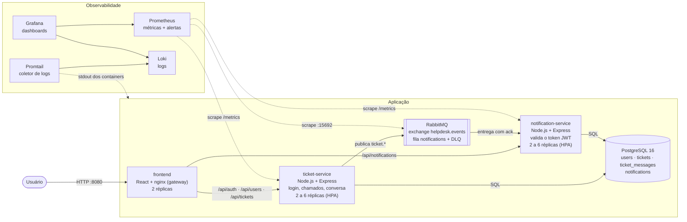
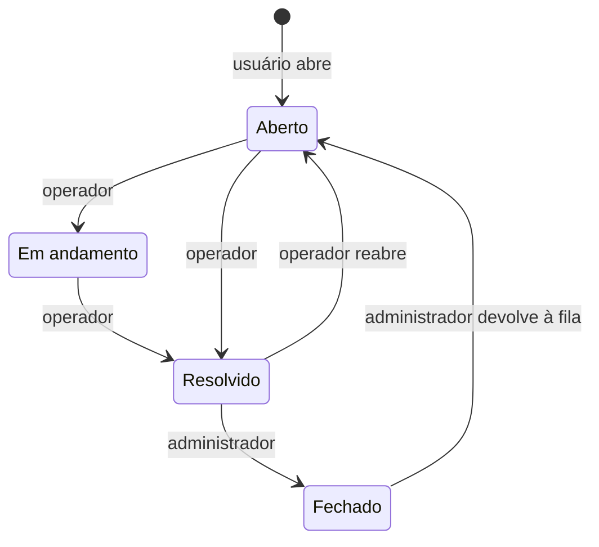
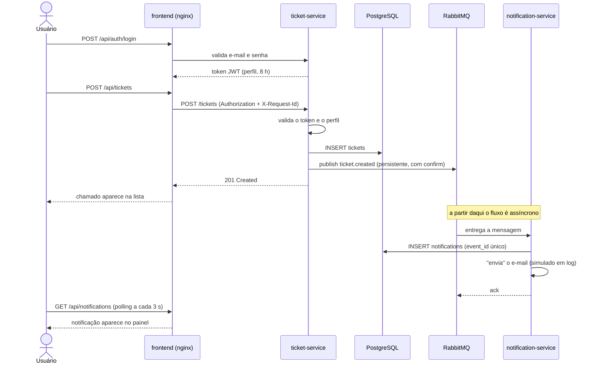
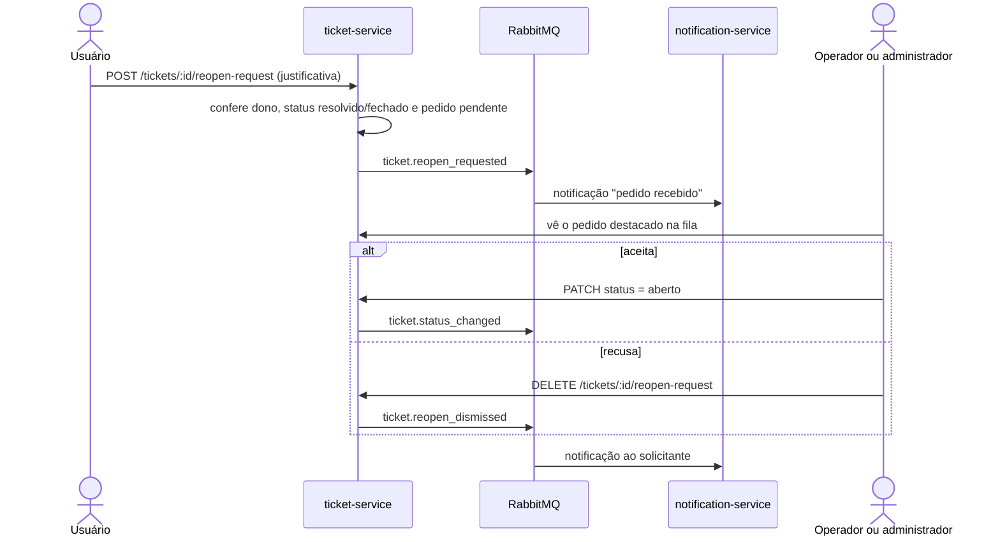
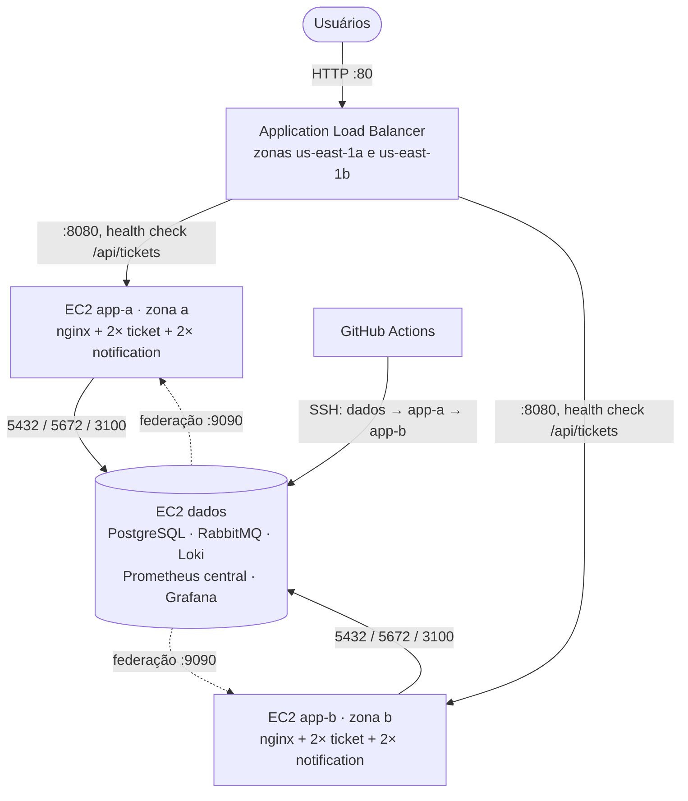

# Arquitetura da solução — HelpDesk Cloud

**Autor:** Joaquim Luiz Vitória Junior · **Disciplina:** Arquitetura de Computação em Nuvem · **Professor:** Erik Rosa Filippini

## 1. Contexto e requisitos

**Problema.** Pedidos de suporte de TI chegam por canais informais, se perdem e não têm acompanhamento. O solicitante não sabe se o pedido foi recebido nem em que pé está.

**Requisitos funcionais**

- Entrar com e-mail e senha, com três perfis de acesso: usuário, operador e administrador; qualquer pessoa pode criar uma conta de usuário.
- Abrir chamado com título, descrição e prioridade (baixa, média, alta); o solicitante é a conta autenticada.
- Acompanhar os chamados com busca e filtros por texto, usuário, prioridade, status e período.
- Atender os chamados conforme o perfil: o operador coloca em andamento, resolve e reabre; só o administrador fecha e, depois de fechado, só ele altera o chamado.
- Resolver ou fechar vários chamados de uma vez, com uma única justificativa.
- Pedir a reabertura de um chamado resolvido ou fechado, com justificativa, sem abrir outro chamado.
- Trocar mensagens de texto dentro do chamado, entre solicitante e atendente (atendimento online), com aviso de mensagem nova.
- Notificar o solicitante quando o chamado é aberto, muda de status, recebe resposta do atendente ou tem o pedido de reabertura analisado.
- Gerir contas e perfis (administrador).

**Requisitos não funcionais**

- A abertura de chamado não pode depender do envio da notificação (desacoplamento por mensageria).
- Nenhum componente de aplicação pode ser ponto único de falha.
- Todo componente expõe métricas e logs estruturados.
- Ambiente reproduzível por código, sem custo de nuvem.

## 2. Desenho da arquitetura



## 3. Componentes

| Componente | Responsabilidade | Detalhes técnicos |
|---|---|---|
| **frontend** | Interface web e ponto único de entrada | SPA em React compilada com Vite. O nginx serve os arquivos estáticos e encaminha `/api/auth`, `/api/users` e `/api/tickets` ao ticket-service e `/api/notifications` ao notification-service, gerando um `X-Request-Id` por requisição. |
| **ticket-service** | Contas e login, CRUD de chamados, conversa e publicação de eventos | API REST em Express. Grava no PostgreSQL e publica `ticket.created`, `ticket.status_changed`, `ticket.message_added`, `ticket.reopen_requested` e `ticket.reopen_dismissed` no RabbitMQ com mensagens persistentes e *publisher confirms*. |
| **notification-service** | Consumo de eventos e registro das notificações | Consome a fila `notifications` com *ack* manual e transforma cada evento em uma notificação ao solicitante. O envio do e-mail é simulado (registrado em log e no banco). Expõe `GET /notifications`, que exige login e filtra por perfil. |
| **RabbitMQ** | Mensageria | Exchange `helpdesk.events` (topic), fila durável `notifications` ligada a `ticket.*` e *dead-letter queue* `notifications.dlq`. |
| **PostgreSQL** | Persistência | Tabelas `users`, `tickets` e `ticket_messages` (dono: ticket-service) e `notifications` (dono: notification-service). Cada serviço cria e acessa apenas as próprias tabelas. |

### API

| Método | Rota | Serviço | Descrição |
|---|---|---|---|
| POST | `/api/auth/login` | ticket-service | Login; devolve o token e os dados da conta |
| POST | `/api/auth/register` | ticket-service | Cria uma conta com o perfil usuário |
| GET, POST | `/api/users` | ticket-service | Lista e cria contas (administrador) |
| PATCH, DELETE | `/api/users/:id` | ticket-service | Altera o perfil ou exclui uma conta (administrador) |
| GET | `/api/tickets` | ticket-service | Lista os chamados (`?status=` opcional) |
| POST | `/api/tickets` | ticket-service | Abre um chamado |
| GET | `/api/tickets/:id` | ticket-service | Consulta um chamado |
| PATCH | `/api/tickets/:id` | ticket-service | Altera o status (operador ou administrador; fechar, só administrador) |
| POST | `/api/tickets/:id/reopen-request` | ticket-service | O solicitante pede a reabertura, com justificativa |
| DELETE | `/api/tickets/:id/reopen-request` | ticket-service | O atendimento recusa o pedido de reabertura |
| POST | `/api/tickets/bulk-status` | ticket-service | Resolve ou fecha vários chamados com uma única justificativa |
| GET | `/api/tickets/:id/messages` | ticket-service | Lista as mensagens da conversa do chamado |
| POST | `/api/tickets/:id/messages` | ticket-service | Envia uma mensagem na conversa |
| GET | `/api/notifications` | notification-service | Lista notificações (`?ticketId=` opcional) |
| GET | `/healthz`, `/readyz`, `/metrics` | ambos | Liveness, readiness e métricas (uso interno) |

## 4. Funcionalidades e regras de negócio

### 4.1 Autenticação e perfis de acesso

O login é feito no `ticket-service`, que guarda as contas na tabela `users` (senha com hash scrypt e salt aleatório) e emite um token JWT assinado (HS256, validade de 8 horas) com o id, o nome, o e-mail e o perfil. O frontend envia o token no cabeçalho `Authorization` e os dois microsserviços o validam com o mesmo segredo (`JWT_SECRET`), sem consulta ao banco nem sessão em memória, o que mantém os serviços sem estado.

| Ação | Usuário | Operador | Administrador |
|---|:-:|:-:|:-:|
| Abrir chamado | Sim | Só pela API | Só pela API |
| Ver chamados | Só os próprios | Todos | Todos |
| Colocar em andamento ou resolver (um a um ou em lote) | Não | Sim | Sim |
| Reabrir chamado resolvido | Não | Sim | Sim |
| Alterar ou devolver à fila um chamado fechado | Não | Não | Sim |
| Fechar chamado (um a um ou em lote) | Não | Não | Sim |
| Pedir reabertura, com justificativa | Só dos próprios | Não | Não |
| Aceitar ou recusar pedido de reabertura | Não | Sim, de chamados resolvidos | Sim |
| Conversar no chamado | Como solicitante, nos próprios | Como atendente | Como atendente |
| Ver notificações | Só as próprias | Todas | Todas |
| Gerir contas e perfis | Não | Não | Sim |

As permissões são verificadas no backend em cada requisição; a tela apenas esconde o que o perfil não pode usar. Um chamado de outra pessoa responde 404 para o perfil usuário, para não revelar que existe.

Limitações conhecidas: o perfil vai dentro do token, então uma mudança de perfil só vale no próximo login; não há bloqueio por tentativas de login nem troca de senha pela tela. A evolução natural é extrair as contas para um serviço de identidade próprio (ou um provedor como Keycloak ou Cognito).

### 4.2 Telas e navegação

A interface é organizada em abas, que variam com o perfil: **Meus chamados**, **Novo chamado** e **Notificações** para o usuário; **Atendimento** e **Notificações** para o operador; e, para o administrador, também **Usuários**. O botão **Conversas**, sempre visível no topo, indica quantas conversas têm mensagens novas.

As capturas de cada tela estão em [docs/telas](../telas/).

A lista de chamados tem busca por texto, por usuário (e-mail do solicitante), prioridade, status e intervalo de datas, além de paginação. Os filtros são aplicados no navegador sobre os 1.000 chamados mais recentes devolvidos pela API. No atendimento, os chamados podem ser marcados um a um ou todos de uma vez (os do filtro atual), e resolvidos ou fechados em lote com uma única justificativa. A justificativa fica gravada no chamado (`close_reason`) e é incluída na notificação enviada a cada solicitante.

### 4.3 Ciclo de vida do chamado



O operador atende, resolve e reabre chamados resolvidos; **fechar é exclusivo do administrador e, depois de fechado, só ele pode alterar o chamado ou devolvê-lo à fila**. Se o problema voltar, o solicitante não precisa abrir outro chamado: ele pede a reabertura do mesmo, com uma justificativa. O pedido aparece destacado na fila do atendimento, que pode aceitar (o chamado volta para "Aberto") ou recusar — se o chamado estiver fechado, essa decisão cabe ao administrador; nos dois casos o solicitante é notificado. Só pode haver um pedido pendente por chamado.

### 4.4 Atendimento online

Cada chamado tem uma conversa. O aviso de mensagem nova usa o resumo da conversa que a API devolve junto de cada chamado (quantidade e autor da última mensagem); o que já foi lido fica registrado no navegador de cada conta. A tela consulta as mensagens a cada 2 segundos (*polling*), o que dispensa WebSocket e mantém os serviços sem estado. Quando o atendente responde, o evento `ticket.message_added` gera uma notificação para o solicitante; mensagens do próprio solicitante são consumidas e ignoradas. Chamados fechados não aceitam novas mensagens. O papel na conversa vem do perfil da conta: usuário fala como solicitante; operador e administrador, como atendente.

## 5. Fluxos

### 5.1 Abertura de chamado (síncrono + assíncrono)



### 5.2 Pedido de reabertura



Se o chamado estiver fechado, só o administrador pode aceitar ou recusar o pedido.

### 5.3 Tratamento de falhas na mensageria

- **notification-service fora do ar:** as mensagens ficam na fila durável e são processadas quando ele volta. A abertura de chamados não é afetada.
- **Falha ao processar (ex.: banco indisponível):** a mensagem recebe *nack* e volta para a fila uma vez. Na segunda falha vai para `notifications.dlq`, onde fica disponível para análise e reprocessamento, e um alerta é disparado.
- **Entrega duplicada:** o `event_id` é chave única na tabela `notifications`, então a mesma mensagem processada duas vezes gera uma única notificação (consumidor idempotente).
- **RabbitMQ fora do ar:** o chamado é gravado normalmente, a falha de publicação é registrada em log e na métrica `events_published_total{result="erro"}`. Os dois serviços se reconectam sozinhos a cada 3 segundos.

## 6. Ambientes

| | Docker Compose (local) | Kubernetes (kind) | Nuvem AWS (AWS Academy) |
|---|---|---|---|
| Finalidade | Desenvolvimento e demo rápida | Demonstração de HA e escalabilidade | Aplicação online, com HA entre servidores |
| Provisionamento | `docker compose up` | Terraform (`infra/terraform`) + Kustomize (`infra/k8s`) | Terraform (`infra/aws`): ALB, 3 EC2, grupos de segurança e Elastic IPs |
| Atualização | Manual | Manual (`kubectl apply -k`) | GitHub Actions a cada push na `main`, um servidor de cada vez |
| Réplicas dos serviços | 2 fixas | 2 a 6, com HPA | 4 (2 em cada servidor de aplicação) |
| Nós | 1 (a máquina local) | 1 control-plane + 2 workers | 2 servidores de aplicação (zonas a e b) + 1 de dados |
| Descoberta de serviço | DNS do Docker | Services do Kubernetes | ALB entre servidores; DNS do Docker dentro de cada um |
| Observabilidade | Prometheus, Loki, Promtail e Grafana em containers | kube-prometheus-stack e loki-stack via Helm | Prometheus por servidor + central com federação; Promtail em cada servidor enviando ao Loki central |

### Infraestrutura como código

O Terraform (`infra/terraform`) cria:

1. o cluster **kind** com três nós e as portas 8080, 3000 e 9090 expostas em `localhost`;
2. o **metrics-server**, que fornece as métricas de CPU usadas pelo HPA;
3. o **kube-prometheus-stack** (Prometheus Operator, Prometheus, Alertmanager e Grafana);
4. o **loki-stack** (Loki e Promtail).

Os manifestos da aplicação (`infra/k8s`) são aplicados com `kubectl apply -k` e incluem Deployments, Services, HPAs, PodDisruptionBudgets, ServiceMonitors, regras de alerta e o dashboard do Grafana.

Na nuvem, o Terraform de `infra/aws` cria, no AWS Academy Learner Lab, uma topologia com alta disponibilidade na camada de aplicação:



1. **Application Load Balancer** em duas zonas de disponibilidade, que verifica a saúde de cada servidor a cada 10 segundos (`/api/tickets` deve responder 401, o que prova que nginx e ticket-service estão vivos) e tira do balanceamento quem falhar duas vezes seguidas;
2. **dois servidores de aplicação** (t3.medium), um em cada zona, cada um com o nginx e duas réplicas de cada microsserviço;
3. **um servidor de dados e observabilidade** com PostgreSQL, RabbitMQ, Loki, o Prometheus central e o Grafana;
4. **grupos de segurança** em camadas: só o ALB fala com a porta 8080 dos servidores de aplicação; só os servidores de aplicação falam com banco, fila e Loki; o Grafana é público, protegido por senha;
5. **Elastic IPs** para o acesso por SSH do GitHub Actions não mudar quando o laboratório religa os servidores.

Os IPs privados são fixos, então cada servidor já nasce sabendo onde estão os outros. O script de inicialização instala o Docker, clona este repositório e sobe a parte que cabe ao servidor (`deploy/aws/dados` ou `deploy/aws/app`). As senhas do banco e da fila e o segredo dos tokens são gerados pelo Terraform e gravados em arquivos `.env` fora do Git.

Na observabilidade, cada servidor de aplicação tem um Prometheus local que coleta as réplicas dele; o Prometheus central lê os dois por **federação**, com o rótulo `node` (app-a ou app-b) em cada série, e o Promtail de cada servidor envia os logs ao Loki central. O mesmo dashboard mostra as 4 réplicas e de que servidor cada uma é.

O workflow `.github/workflows/deploy-aws.yml` testa os microsserviços, constrói as imagens e atualiza por SSH o servidor de dados e depois **um servidor de aplicação de cada vez**, esperando cada um voltar a responder antes de seguir. Passo a passo e roteiro de testes de alta disponibilidade: [docs/AWS-ACADEMY.md](../AWS-ACADEMY.md).

## 7. Alta disponibilidade e escalabilidade

| Mecanismo | Como foi implementado | O que garante |
|---|---|---|
| **Réplicas** | Mínimo de 2 réplicas de frontend, ticket-service e notification-service | A queda de uma réplica não interrompe o serviço |
| **Serviços sem estado** | Nenhum serviço guarda sessão ou dado em memória; todo o estado está no PostgreSQL e no RabbitMQ | Qualquer réplica atende qualquer requisição; escalar é só adicionar réplicas |
| **Distribuição entre nós** | `topologySpreadConstraints` por `kubernetes.io/hostname` | A queda de um nó não derruba todas as réplicas de um serviço |
| **Health checks** | `startupProbe`, `livenessProbe` (`/healthz`) e `readinessProbe` (`/readyz`, que testa o banco) | Réplica travada é reiniciada; réplica sem banco sai do balanceamento |
| **Escalabilidade horizontal** | `HorizontalPodAutoscaler` de 2 a 6 réplicas, alvo de 70% de CPU | Capacidade acompanha a carga automaticamente |
| **Consumidores concorrentes** | Várias réplicas do notification-service na mesma fila, com `prefetch` de 10 | A vazão de notificações escala com o número de réplicas |
| **Deploy sem indisponibilidade** | `RollingUpdate` com `maxUnavailable: 0` e encerramento gracioso no `SIGTERM` | Atualização de versão sem derrubar requisições |
| **Proteção em manutenção** | `PodDisruptionBudget` com `minAvailable: 1` | Drenar um nó nunca remove todas as réplicas |
| **Desacoplamento** | Mensageria entre chamados e notificações | Falha ou lentidão nas notificações não afeta a abertura de chamados |
| **Resiliência de mensagens** | Fila durável, mensagens persistentes, *publisher confirms*, *ack* manual, DLQ, idempotência | Nenhuma notificação é perdida nem duplicada em caso de falha |
| **Load balancer entre zonas (AWS)** | Application Load Balancer com dois servidores de aplicação em zonas diferentes e health check a cada 10 s | A queda de um servidor ou de uma zona inteira não tira a aplicação do ar |
| **Deploy gradual (AWS)** | GitHub Actions atualiza um servidor de aplicação de cada vez e espera ele responder | Atualização sem desligar a aplicação |
| **Reconexão automática** | Retentativas de conexão com o banco e com o broker | Os serviços se recuperam sozinhos da volta de uma dependência |

### Limitações conhecidas do ambiente local

PostgreSQL e RabbitMQ rodam com **uma instância cada**, inclusive na AWS, onde ficam no servidor de dados. Eles são os pontos únicos de falha desta implantação; a camada de aplicação, na AWS, já tem redundância entre zonas. Além disso, a publicação do evento ocorre depois do *commit* no banco; se o broker estiver fora nesse instante, o chamado é salvo, mas o evento não é publicado.

### Evolução para produção em nuvem

| Componente local | Equivalente gerenciado (exemplo AWS) | Ganho |
|---|---|---|
| kind | EKS em três zonas de disponibilidade, com Cluster Autoscaler ou Karpenter | HA de control-plane e de nós; escala de infraestrutura |
| PostgreSQL em StatefulSet | RDS/Aurora PostgreSQL Multi-AZ com réplicas de leitura | Failover automático e backups |
| RabbitMQ em StatefulSet | Amazon MQ em cluster, ou SQS + SNS | Fila replicada entre zonas |
| NodePort | Application Load Balancer + Ingress, com TLS | Entrada balanceada e segura |
| Secret em manifesto | Secrets Manager + External Secrets | Segredos fora do Git |
| Publicação após o commit | Padrão *Transactional Outbox* | Garantia de publicação de todo evento |
| HPA por CPU | KEDA escalando o notification-service pelo tamanho da fila | Escala pelo indicador real de demanda |
| Contas e tokens no ticket-service | Amazon Cognito (ou Keycloak) como provedor de identidade | Senhas, MFA e bloqueio por tentativas fora da aplicação |
| Envio de e-mail simulado | Amazon SES, ou uma função serverless (Lambda) acionada pela fila | Envio real e cobrança por uso |

## 8. Monitoramento e observabilidade

A solução cobre os pilares de **métricas** e **logs**, com correlação entre eles pelo identificador da requisição e do evento.

### 8.1 Métricas (Prometheus)

Cada microsserviço expõe `/metrics` com a biblioteca `prom-client`. O Prometheus descobre todas as réplicas automaticamente (DNS no Compose, `ServiceMonitor` no Kubernetes) e coleta a cada 10 segundos.

| Métrica | Tipo | Origem | Uso |
|---|---|---|---|
| `http_request_duration_seconds` | Histograma | ambos | Taxa de requisições, latência (p95) e taxa de erro, por rota e status |
| `tickets_created_total` | Contador | ticket-service | Indicador de negócio: chamados abertos, por prioridade |
| `tickets_status_changed_total` | Contador | ticket-service | Mudanças de status |
| `ticket_messages_total` | Contador | ticket-service | Mensagens da conversa, por papel do autor |
| `ticket_reopen_requests_total` | Contador | ticket-service | Pedidos de reabertura, solicitados e recusados |
| `auth_logins_total` | Contador | ticket-service | Tentativas de login, aceitas e recusadas |
| `events_published_total` | Contador | ticket-service | Eventos publicados, com sucesso ou erro |
| `events_consumed_total` | Contador | notification-service | Eventos consumidos: ok, duplicado, descartado ou erro |
| `event_processing_duration_seconds` | Histograma | notification-service | Tempo de processamento de cada evento |
| `event_delivery_lag_seconds` | Histograma | notification-service | Tempo entre publicação e processamento (atraso da fila) |
| `rabbitmq_queue_messages_ready` | Gauge | RabbitMQ | Mensagens acumuladas na fila e na DLQ |
| `process_*`, `nodejs_*` | diversos | ambos | CPU, memória, *event loop* e *garbage collector* |
| `up` | Gauge | Prometheus | Réplicas no ar |

Essas métricas seguem o método **RED** (Rate, Errors, Duration) para as APIs e acrescentam indicadores de negócio e de mensageria.

### 8.2 Logs (Loki + Promtail)

- Os serviços escrevem **logs estruturados em JSON** no `stdout` (biblioteca `pino`), com `service`, `level`, `time`, e os campos de contexto `req.id`, `userId`, `ticketId`, `eventId` e `eventType`. Senhas e tokens nunca são registrados.
- O **Promtail** coleta o `stdout` de todos os containers e envia ao **Loki**, com os labels `service` (ou `app`, no Kubernetes) e `level`.
- O nginx gera um `X-Request-Id` e o repassa ao backend, e cada evento carrega o próprio `id`. Assim é possível seguir um chamado de ponta a ponta com uma consulta como:

```logql
{service=~"ticket-service|notification-service"} |= "<id do chamado>"
```

Eventos de aplicação registrados: `login realizado`, `login recusado`, `conta criada`, `perfil alterado`, `chamado aberto`, `status do chamado alterado`, `status alterado em lote`, `mensagem registrada no chamado`, `reabertura solicitada`, `pedido de reabertura recusado`, `evento publicado`, `notificação enviada (simulada)`, `evento duplicado ignorado`, falhas de publicação ou de consumo e reconexões.

### 8.3 Dashboard (Grafana)

O dashboard **"HelpDesk Cloud - Visão geral"** é provisionado automaticamente a partir do repositório, e reúne:

- réplicas no ar por serviço, chamados abertos, notificações enviadas, mensagens na fila e na DLQ;
- requisições por segundo, latência p95 e percentual de erros 5xx por serviço;
- eventos publicados e consumidos, e atraso de entrega;
- distribuição das requisições entre as réplicas (evidência do balanceamento);
- CPU, memória e atraso do *event loop* por réplica;
- painel de logs em tempo real vindo do Loki.

### 8.4 Alertas

Definidos em `infra/observability/alerts.yml` (Compose) e `infra/k8s/alerts.yaml` (Kubernetes):

| Alerta | Condição | Severidade |
|---|---|---|
| `ServicoFora` | Réplica sem responder ao scrape por 1 minuto | crítica |
| `TaxaDeErroAlta` | Mais de 5% de respostas 5xx por 5 minutos | aviso |
| `LatenciaP95Alta` | p95 acima de 500 ms por 5 minutos | aviso |
| `FilaDeNotificacoesAcumulando` | Mais de 100 mensagens paradas por 5 minutos | aviso |
| `MensagensNaDLQ` | Qualquer mensagem na dead-letter queue | aviso |

No Kubernetes os alertas chegam ao Alertmanager, instalado pelo kube-prometheus-stack; o roteamento para e-mail ou Slack é a evolução natural.

## 9. Requisitos da atividade

| Requisito | Atendimento |
|---|---|
| Aplicação de três camadas | Frontend React, backend Node.js e PostgreSQL |
| Resolve um problema real | Gestão de chamados de suporte com perfis de acesso, atendimento online e retorno ao solicitante |
| Microsserviços em Docker ou Kubernetes | Dois microsserviços e um frontend, em Docker Compose e em Kubernetes |
| Serverless e/ou mensageria | Mensageria com RabbitMQ entre os dois microsserviços |
| IaC | Terraform, manifestos Kubernetes e Docker Compose |
| Alta disponibilidade | Seção 7 |
| Monitoramento e observabilidade | Seção 8 |
